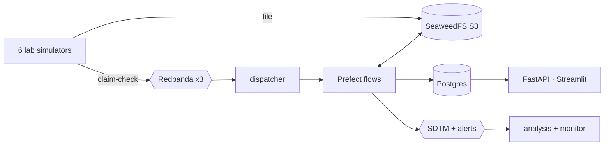

# multi-omics

A working prototype of a multi-source, multi-omics measurement pipeline. It ingests, validates, normalizes and exposes lab data while preserving provenance. It was built as a data-engineering exercise; the original brief is kept locally and is not part of the repo.

Six simulated labs deliver files:

- a clinic (vitals, enrollment, biobank manifest)
- two clinical chemistry labs (CRP, hs-CRP)
- Olink proteomics
- **real open data**: 1000 Genomes DNA and Geuvadis RNA

Files land in S3 and small claim-check events travel over a 3-broker Redpanda cluster. Prefect flows harmonize every row into one append-only store with row-level lineage. It is published as CDISC SDTM through an API, topics and a dashboard.



## The brief, and where each part lives

| Brief | Implementation |
| --- | --- |
| Standardize measurement capture | One YAML contract per source → canonical measurement → CDISC SDTM ([data standards](docs/data-standards.md)) |
| Shared data layer and domains | Postgres schemas per domain, one role per service; research reads only research-safe views ([architecture](docs/architecture.md)) |
| Idempotent pipeline with lineage | Content-derived IDs, append-only versions, one transaction per file, raw row → file → S3 lineage |
| Unified access layer | FastAPI with API keys, roles and an audit log; topics; dashboard ([security](docs/security.md)) |
| Discussion topics and scale | `make demo` proves each topic; `make chaos` and `make replay` prove resilience ([decisions](docs/decisions.md)) |

## Quickstart

You need Docker with about 6 GB of RAM. Then:

```sh
make demo       # clean run + one check per topic of the brief + replay (~3.5 min)
make chaos      # same scenario while crashing workers and a broker (~3 min)
make help       # every command
```

| UI | URL |
| --- | --- |
| Dashboard: system state, data quality, cohorts, lineage, analysis, ontology | <http://localhost:8501> |
| API docs: SDTM, lineage, quality (header `X-API-Key: research-key-dev` or `ops-key-dev`) | <http://localhost:8000/docs> |
| Redpanda Console (topics, brokers, consumer lag) | <http://localhost:8080> |
| Prefect (flow runs, retries) | <http://localhost:4200> |
| SeaweedFS filer (browse S3 files) | <http://localhost:8888> |

```sh
curl -s -H 'X-API-Key: research-key-dev' \
  'localhost:8000/sdtm/LB?usubjid=CARDIO-01-P001&testcd=CRP'
```

## Verified results

- **`make demo`:** 14/14 checks pass, covering idempotency, entity resolution, normalization, validation, corrections, late data, schema evolution, fault tolerance, lineage, access control, analysis, monitoring, multi-omics and determinism. The replay reproduces the golden checksum exactly.
- **`make chaos`:** random task crashes, the dispatcher and the analysis consumer down, the flow-runner `kill -9`'d and one broker stopped. Everything settles by itself, with the **same checksum** as a clean run.
- **Real biology from open data:** ERAP2 expression vs rs2248374 genotype, r = −0.89, p = 3e-21.

## Docs

| Doc | Contents |
| --- | --- |
| [Walkthrough](docs/walkthrough.md) | A 60-minute tour, and where every topic lives |
| [Architecture](docs/architecture.md) | Mermaid diagrams: system, one upload, file states, data model, resilience |
| [Data standards](docs/data-standards.md) | LOINC, UCUM, UniProt, Ensembl, dbSNP, ISO 8601 in; SDTM out |
| [Security](docs/security.md) | What is enforced now, and what production adds |
| [Decisions](docs/decisions.md) | Tradeoffs, omissions, scale path |
| [Glossary](docs/glossary.md) | Strict definitions and a concept map |
| [Runbook](docs/runbook.md) | Commands, URLs, troubleshooting |
| [Open data sources](data/open/SOURCES.md) | Provenance of the DNA/RNA deliveries |
| [CLAUDE.md](CLAUDE.md) | Coding conventions (KISS, PEP 257, under 1000 lines per file) |
