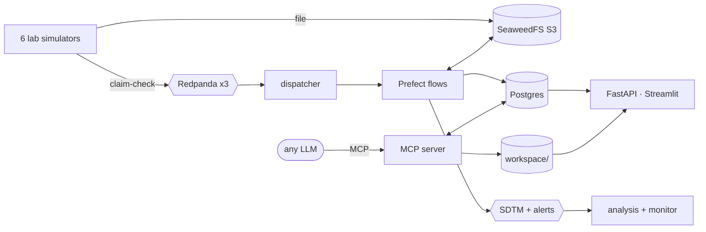

# multi-omics

A working prototype of a multi-source, multi-omics measurement pipeline. It ingests, validates, normalizes and exposes lab data while preserving provenance. It was built as a data-engineering exercise; the original brief is kept locally and is not part of the repo.

Six simulated labs deliver files:

- a clinic (vitals, enrollment, biobank manifest)
- two clinical chemistry labs (CRP, hs-CRP)
- Olink proteomics
- **real open data**: 1000 Genomes DNA and Geuvadis RNA

They cover four studies: three observational case/control studies and **IBD-04, a simulated placebo-controlled trial** of a fictional ERAP2 inhibitor, built on its participants' real genetics.

Files land in S3 and small claim-check events travel over a 3-broker Redpanda cluster. Prefect flows harmonize every row into one append-only store with row-level lineage. It is published as CDISC SDTM through an API, topics and a dashboard.

**Any LLM can ask the data.** An MCP server publishes the ontology, which links DNA → RNA → protein → drug and study, together with the data catalog and the research-safe data. An LLM explores what the data means, queries it, and saves the pipelines and dashboards it builds. They are saved as a subtree: YAML files in `workspace/`, nodes in the graph, pages in the dashboard. See [agent.md](docs/agent.md).



## The brief, and where each part lives

| Brief | Implementation |
| --- | --- |
| Standardize measurement capture | One YAML contract per source → canonical measurement → CDISC SDTM ([data standards](docs/data-standards.md)) |
| Shared data layer and domains | Postgres schemas per domain, one role per service; research reads only research-safe views ([architecture](docs/architecture.md)) |
| Idempotent pipeline with lineage | Content-derived IDs, append-only versions, one transaction per file, raw row → file → S3 lineage |
| Unified access layer | FastAPI with API keys, roles and an audit log; topics; dashboard ([security](docs/security.md)) |
| Discussion topics and scale | `make demo` proves each topic; `make chaos` and `make replay` prove resilience ([decisions](docs/decisions.md)) |

## Quickstart

You need Docker with about 6 GB of RAM. Then:

```sh
make demo       # clean run + one check per topic of the brief + replay (~3.5 min)
make chaos      # same scenario while crashing workers and a broker (~3 min)
make help       # every command
```

| UI | URL |
| --- | --- |
| Dashboard: system state, data quality, cohorts, lineage, analysis, ontology | <http://localhost:8501> |
| API docs: SDTM, lineage, quality (header `X-API-Key: research-key-dev` or `ops-key-dev`) | <http://localhost:8000/docs> |
| MCP server for LLMs (bearer `agent-token-dev`; Claude Code reads `.mcp.json`) | <http://localhost:8001/mcp> |
| Redpanda Console (topics, brokers, consumer lag) | <http://localhost:8080> |
| Prefect (flow runs, retries) | <http://localhost:4200> |
| SeaweedFS filer (browse S3 files) | <http://localhost:8888> |

```sh
curl -s -H 'X-API-Key: research-key-dev' \
  'localhost:8000/sdtm/LB?usubjid=CARDIO-01-P001&testcd=CRP'
```

## Verified results

- **`make demo`:** 16/16 checks pass, covering idempotency, entity resolution, normalization, validation, corrections, late data, schema evolution, fault tolerance, lineage, access control, analysis, monitoring, multi-omics, drug response, LLM access and determinism. The replay reproduces the golden checksum exactly.
- **`make chaos`:** random task crashes, the dispatcher and the analysis consumer down, the flow-runner `kill -9`'d and one broker stopped. Everything settles by itself, with the **same checksum** as a clean run.
- **Real biology from open data:** ERAP2 expression vs rs2248374 genotype, r = −0.83, p = 2e-26 (n = 99).
- **Did the drug work?** In IBD-04, CRP fell to ×0.42 of baseline on OMX-101 in people who make ERAP2, vs ×0.84 on placebo. G/G people, who make no ERAP2, didn't respond (×1.02).
- **An LLM can answer that itself:** Claude, using only the MCP tools, found the drug → target → gene → variant chain, then built three pipelines and the dashboard `omx101_trial`. They are committed in `workspace/`.

## Repository layout

```text
.
├── contracts/              one YAML per source: file pattern, columns per version, codes, natural key
├── reference/              ontology as code: studies, concepts (LOINC, UniProt, Ensembl, dbSNP), units, graph
├── db/
│   ├── migrations/         numbered schema changes, each applied once
│   └── repeatable/         the published api.* views and the grants, re-applied on every init
├── src/omics/              the one Python package every container runs
│   ├── contracts.py        loads contracts/, picks the version from the header
│   ├── parse.py            csv, wide matrix (RNA) and VCF (DNA) readers
│   ├── quality.py          sanitizing, units, plausible vs reference ranges
│   ├── harmonize.py        one raw row -> a canonical measurement or a quarantine issue (pure)
│   ├── load.py             one transaction per file, append-only insert, retries, outbox
│   ├── flows.py            Prefect flows: ingest-file, reconcile, refresh-workspace
│   ├── models.py           claim-check events, SDTM records, alerts (pydantic)
│   ├── cli.py              init, replay, checksum, settle
│   ├── db.py · s3.py · bus.py · settings.py    thin wrappers around Postgres, S3, Redpanda, env
│   ├── agent/              MCP server for LLMs: ontology tools, guarded queries, the workspace
│   ├── services/           lab simulator, dispatcher, analysis and monitor consumers
│   ├── api/                FastAPI: SDTM endpoints, API keys -> roles, audit log
│   └── dashboard/          Streamlit app; views/ = one file per page, workspace.py = LLM-built pages
├── scripts/                generate_synthetic, fetch_open_data, demo (make demo), chaos (make chaos)
├── data/
│   ├── scenario/           what each simulated lab delivers on days 1-3, plus the golden checksum
│   └── open/               provenance + sample map of the real DNA/RNA; raw/ is a git-ignored cache
├── workspace/              what LLMs built over MCP: pipelines/ (SQL) and dashboards/ (panels), YAML
├── config/                 SeaweedFS S3 identities, Postgres bootstrap SQL
├── docs/                   architecture (Mermaid), standards, security, LLM access, decisions, runbook
├── tests/
│   ├── unit/               pure logic and repo conventions (PEP 257, 1000-line limit)
│   └── integration/        API, MCP, demo and dashboard against the running stack
├── docker-compose.yml      the whole platform: infrastructure, services, simulators
├── Dockerfile              the single Python image (bcftools included)
├── Makefile                every command (`make help`)
├── .env.example            dev credentials, copied to .env by make
├── .mcp.json               connects Claude Code (or any MCP host) to the platform's MCP server
├── .streamlit/             dashboard theme
└── .github/workflows/      CI: ruff + unit tests on every push
```

## Docs

| Doc | Contents |
| --- | --- |
| [Walkthrough](docs/walkthrough.md) | A 60-minute tour, and where every topic lives |
| [Ask the data (MCP)](docs/agent.md) | Tools, guardrails, connecting any LLM, the worked drug-trial example |
| [Architecture](docs/architecture.md) | Mermaid diagrams: system, one upload, file states, data model, resilience |
| [Data standards](docs/data-standards.md) | LOINC, UCUM, UniProt, Ensembl, dbSNP, ISO 8601 in; SDTM out |
| [Security](docs/security.md) | What is enforced now, and what production adds |
| [Decisions](docs/decisions.md) | Tradeoffs, omissions, scale path |
| [Glossary](docs/glossary.md) | Strict definitions and a concept map |
| [Runbook](docs/runbook.md) | Commands, URLs, troubleshooting |
| [Open data sources](data/open/SOURCES.md) | Provenance of the DNA/RNA deliveries |
| [CLAUDE.md](CLAUDE.md) | Coding conventions (KISS, PEP 257, under 1000 lines per file) |
