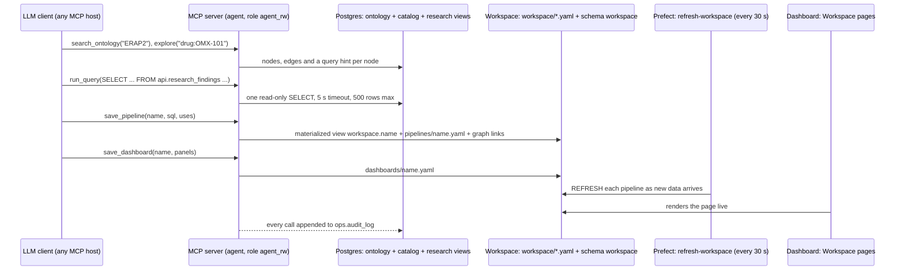

# Ask the data: an ontology any LLM can query (MCP)

The platform publishes its knowledge graph, its data catalog and its research-safe data over the **Model Context Protocol (MCP)**, the open standard that LLM clients use for tools. Any MCP client can connect to `http://localhost:8001/mcp`: Claude Code, Claude Desktop, the OpenAI Agents SDK, Gemini CLI, Cursor or a plain script. Once connected it can:

- find out what the data means
- query it
- save what it builds (pipelines and dashboards) as a **subtree** of the repo, of the graph and of the dashboard

This goes one step beyond a Spark job. A Spark job computes what a data engineer wrote in advance; here the analyst asks a question, and the LLM writes the computation against a vocabulary the platform defines.

## How one question flows

## The tools

| Tool | What it does |
| --- | --- |
| `search_ontology(text)` | Finds nodes by id, label or definition. "ERAP2" returns the gene, the protein (UniProt Q6P179), the variant rs2248374, the RNA and protein tests, and the drug |
| `explore(node_id, depth)` | Returns the neighbourhood, up to 3 hops. From `drug:OMX-101`: the target protein, the gene that encodes it, the variant that controls it, the assays that measure them, the trial arm and the disease |
| `describe_datasets()` | Lists the datasets this client may read, with what each column means (Postgres `COMMENT`s, `db/repeatable/110_catalog.sql`) |
| `run_query(sql)` | Runs one read-only PostgreSQL SELECT and returns columns and rows |
| `save_pipeline(name, title, description, sql, uses)` | Saves the SELECT as `workspace.<name>`, kept current by Prefect, plus its YAML file and its links in the graph |
| `save_dashboard(name, title, description, panels)` | Saves a page of panels (bar, line, scatter, box, table, metric) that read pipelines. It appears at `http://localhost:8501/<name>` |
| `list_workspace()` / `drop_artifact(kind, name)` | Shows the subtree, or removes an attempt (refused while something still uses it) |
| resource `omics://glossary` | The strict definitions in [glossary.md](glossary.md) |

The server's `instructions` (sent to every client when it connects) carry four rules:

- the data is research-safe
- NPX is log2-relative and is never converted
- a genotype is given as its ALT-allele dosage
- every answer reports n per group

## Guardrails: in the database, not the prompt

| Risk | Control |
| --- | --- |
| Seeing what research may not | The `agent_rw` role can SELECT only the research-safe views (`api.research_findings`, `api.sdtm_dm`, `api.study_arms`, `api.samples`, the ontology), the `research.*` results and its own workspace. It has no access to ops, raw, sci or quarantine, and held participants are invisible in the findings |
| Destructive SQL | Each query runs in a read-only transaction, wrapped as a subquery. That stops a plain second statement, but not a crafted one that closes the subquery and commits, so the real boundary is the role: it has no write grant outside `workspace`. Planned: the extended query protocol, and read-only plus a timeout set on the role itself |
| Runaway queries | 5 s timeout and a 500-row cap; a pipeline build gets 30 s |
| Unsafe output | Nothing an LLM writes runs as code. Pipelines are SQL views, dashboards are validated specs, names are checked identifiers (still to add for `drop_artifact`), and files are only written under `workspace/` |
| Unattributed use | One bearer token per client (`AGENT_TOKENS`). Every call is logged in `ops.audit_log` with the client, tool, arguments, status and row count |

## Saved as a subtree

Every artifact exists three times, and each copy is derived from the same file:

1. **Files** in `workspace/pipelines/*.yaml` and `workspace/dashboards/*.yaml`.
   - They are the source of truth, reviewable in a pull request.
   - The field order is fixed and there are no timestamps, so saving the same spec twice changes nothing.
   - `git subtree split --prefix=workspace -b workspace` publishes the folder as its own branch or repo.
2. **Graph nodes:**
   - `workspace` → `contains` → `pipeline:*` → `reads` `dataset:*` or `pipeline:*` (lineage taken from Postgres' own `pg_depend`)
   - pipelines → `uses` → the tests, variants and drugs they are about
   - `dashboard:*` → `shows` → the pipelines it reads

   To see it, open the dashboard's Ontology page and focus on `workspace`.
3. **Pages** in the dashboard's "Workspace (built by LLMs)" section.

`make reset` wipes the database but not the files. `init` rebuilds the views from the YAML, retrying until nothing changes because one pipeline may read another, and the refresh flow fills them as the data arrives.

## Connect a client

The stack must be up (`make up`). The token below is the dev token from `.env.example`.

| Client | How |
| --- | --- |
| Claude Code | `.mcp.json` in the repo root defines the `omics` server. Approve it when prompted, or check it with `/mcp`. Without the file: `claude mcp add --transport http omics http://localhost:8001/mcp --header "Authorization: Bearer agent-token-dev"` |
| OpenAI Agents SDK | `MCPServerStreamableHttp(params={"url": "http://localhost:8001/mcp", "headers": {"Authorization": "Bearer agent-token-dev"}})` |
| Gemini CLI | in `settings.json`: `"mcpServers": {"omics": {"httpUrl": "http://localhost:8001/mcp", "headers": {"Authorization": "Bearer agent-token-dev"}}}` |
| No LLM at all | `npx @modelcontextprotocol/inspector`, transport Streamable HTTP, plus the header |
| Python | `mcp.Client` over `streamable_http_client`, as in `tests/integration/test_agent.py` |

## Worked example: did my drug work?

The prompt, as a bioinformatician would ask it:

> Did OMX-101 work in IBD-04? In which population groups? Is the drug's target expressed in RNA and also measured as protein?

What Claude did, through the tools only:

1. **Learned the vocabulary.** It read the server instructions, ran `search_ontology("OMX-101")`, then `explore("drug:OMX-101", 3)`. That walk gave the drug → `targets` → protein Q6P179 ← `encodes` ← gene ERAP2 ← `in_gene` ← rs2248374, the tests measuring each, and the IBD-04 arms.
2. **Checked the data.** It used `run_query` to see which tests exist at which `VISIT`: all 40 participants have CRP and Olink at BASELINE and WEEK 12, and RNA and DNA at baseline.
3. **Built three pipelines.** The first, `omx101_participants`, has one row per participant. `omx101_response_by_group` and `erap2_rna_protein_by_genotype` read it.
4. **Built a dashboard.** `omx101_trial` is live at <http://localhost:8501/omx101_trial>.

The answer, from the saved pipelines (each ratio is rounded before the median is taken, so the demo check, which uses unrounded values, reports ×0.42):

| Arm | rs2248374 group | n | CRP week 12 / baseline | IL6 change (NPX) |
| --- | --- | --- | --- | --- |
| OMX-101 | A carrier (makes ERAP2) | 17 | **×0.43** | −0.94 |
| Placebo | A carrier | 18 | ×0.84 | +0.02 |
| OMX-101 | G/G (no ERAP2) | 3 | ×1.02 | −0.21 |
| Placebo | G/G | 2 | ×1.04 | +0.09 |

| Genotype | n | ERAP2 RNA (nRPKM, real) | ERAP2 protein (NPX) |
| --- | --- | --- | --- |
| A/A | 13 | 36.0 | 5.42 |
| A/G | 22 | 21.9 | 5.13 |
| G/G | 5 | 5.1 | 3.21 |

**Conclusion:** the drug worked, but only in people who make its target. G/G people make almost no ERAP2 mRNA, so almost no protein, and they don't respond. The G/G groups are small (n = 3 and 2).

The data behind this is part real and part planted:

- **Real:** the genetics and the RNA.
- **Planted:** the drug and its effect; see [data standards](data-standards.md#simulated-trial-ibd-04).

The pipelines and dashboard are committed in `workspace/` as the worked example, and `make demo` checks that they are rebuilt after a reset.

## What production adds

- **Real identity:** OAuth 2.1 tokens per user, as the MCP authorization spec describes, instead of static dev tokens; scopes per study; row-level security.
- **Where the data goes:** pseudonymous subject-level rows still reach the LLM provider. Production would use a self-hosted model or a provider under a BAA/DPA, or an aggregate-only role with a minimum cell size.
- **Promotion:** workspace changes reviewed as pull requests (they are just files) before others rely on them.
- **Quotas:** per-client rate and cost limits on top of the statement timeout.
