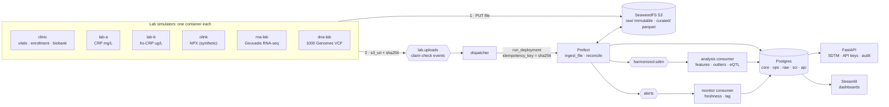
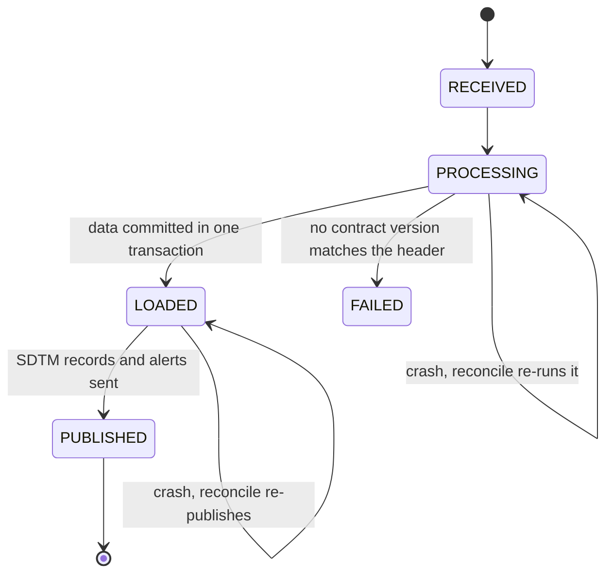
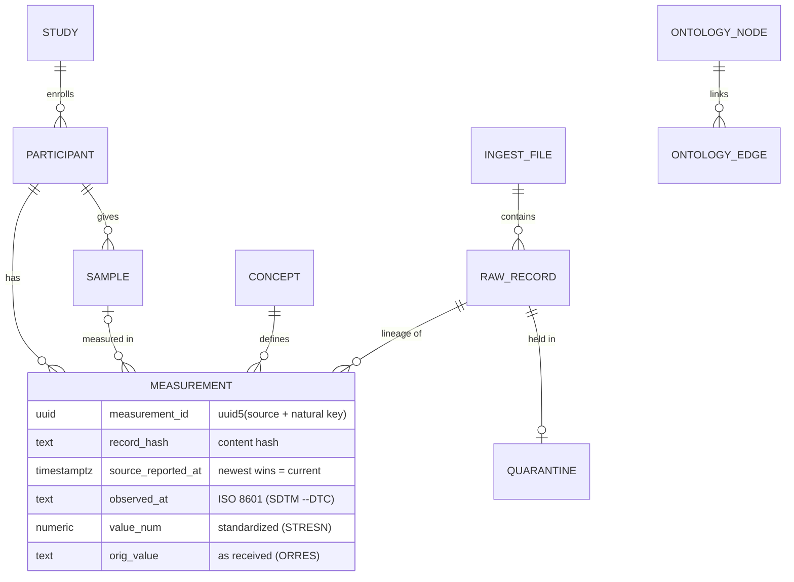

# Architecture

> **Status:** M0–M4 built: everything the brief asks for. `make demo` proves each topic, `make chaos` proves self-healing, and `make replay` proves replayability. The [plan and milestones](#milestones) are at the end.

**Kafka carries messages, not data.**
- Labs upload files to S3 and publish a small *claim-check* event (S3 URI + sha256).
- Prefect flows fetch the file, then harmonize it into Postgres.
- The flows publish CDISC SDTM records for the downstream consumers.

## System



| Component | Why it is there |
| --- | --- |
| Redpanda ×3 (Kafka API) | Durable, replayable event log. RF=3 with min ISR=2, so one broker can crash without losing data |
| SeaweedFS (S3) | Holds the data itself; raw files are content-addressed, so they are never overwritten. MinIO's repo was archived in Apr 2026; SeaweedFS is Apache-2.0 and has run in production since 2012 |
| Prefect | Retries, run history and UI for the pipelines; the reconcile flow re-runs stuck work |
| Postgres | The harmonized store and pipeline state; domain separation via schemas and roles |
| FastAPI | The unified access layer: SDTM records, history and lineage behind API keys and roles; every request audited ([security](security.md)) |

## One upload, end to end

```mermaid
sequenceDiagram
  autonumber
  participant L as Lab simulator
  participant S as SeaweedFS (S3)
  participant K as Redpanda
  participant D as Dispatcher
  participant P as Prefect ingest_file
  participant DB as Postgres
  L->>S: PUT raw/<lab>/<sha256>/<file>
  L->>K: lab.uploads {s3_uri, sha256, uploaded_at}
  K->>D: deliver (at-least-once)
  D->>DB: register file as RECEIVED (from now on it cannot be lost)
  D->>P: run_deployment(idempotency_key = sha256:attempts)
  D->>K: commit offset, only after Prefect accepted the run
  P->>S: GET file, verify sha256
  P->>DB: ONE transaction: raw rows, measurements, quarantine, retry pending, LOADED
  P->>K: outbox drain: harmonized.sdtm records + alerts
  P->>DB: mark sent, status PUBLISHED
  Note over P,DB: every 60 s, reconcile re-runs files stuck before PUBLISHED<br/>(new key: attempts + 1; safe because everything is idempotent)
```

## File status



## Resilience and replay

Every run is judged by one number: the **checksum of all derived data**. It covers the measurements, the masters and the open quarantine, and leaves out wall-clock bookkeeping. The same input files must always give the golden checksum (`data/scenario/expected_checksum.txt`), however they arrive.

| Command | What happens | Verified result |
| --- | --- | --- |
| `make demo` | Clean run of the 3-day scenario, then a check per topic of the brief, then a replay | 11/11 checks ✅; replay identical ✅ |
| `make chaos` | The same scenario under four failures (timeline below) | settles by itself; golden checksum ✅ |
| `make replay` | Truncate everything derived, re-run every file from S3 under new idempotency keys | identical checksum ✅ |

The four failures in `make chaos`:
- 30% random task crashes, which Prefect retries.
- The dispatcher is down for 20 s; events queue in Redpanda.
- The flow-runner is `kill -9`'d mid-batch; reconcile re-runs the files it dropped.
- One of three brokers is stopped.

**Why it converges:**
- IDs and hashes are derived from content.
- Measurements are append-only rows, and "current" is a view.
- Operational masters decide entity resolution.
- Held rows are retried until a fixed point.
- If the same content arrives twice, the earliest delivery's lineage is kept.

In one demo run the labs beat the clinic, so 601 rows waited for their master data. The checksum was still identical to the golden run, in which almost nothing waited.

## Data model



| Schema | Owner role | Contents |
| --- | --- | --- |
| `core` | pipeline_rw | shared concepts: study, participant, sample (operational masters); concept, units, ontology |
| `ops` | pipeline_rw | ingest_file (status machine), quarantine |
| `raw` | pipeline_rw | bronze: every source row as JSONB |
| `sci` | pipeline_rw | append-only measurements (a correction is a new row) |
| `api` | (views) | the published contract, readable by api_ro, research_rw and monitor_rw |
| `research` | research_rw | analysis consumer output |
| `monitor` | monitor_rw | monitor consumer output |

## Milestones

|  | Milestone | Status |
| --- | --- | --- |
| M0 | Foundations: compose, init (roles, migrations, reference data, buckets, topics), lint | ✅ done |
| M1 | Thin slice: simulators → S3 + Redpanda → dispatcher → Prefect → Postgres → SDTM | ✅ done |
| M2 | Quality and standards: sanitization, units, ranges, holds, alerts, corrections | ✅ done |
| M3 | Access and security: FastAPI (keys/roles, audit), DB roles, S3 identities | ✅ done |
| M4 | Resilience: reconcile, chaos, reset/replay/checksum, `make demo` **(cut line)** | ✅ done |
| M5 | Consumers and dashboards | planned |
| M6 | Open multi-omics: 1000 Genomes + Geuvadis, Dask eQTL, ontology graph | planned |
| M7 | Polish: README, decisions, CI, final deck, 1-hour walkthrough | planned |
