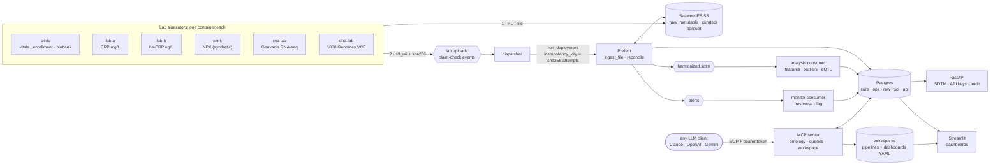
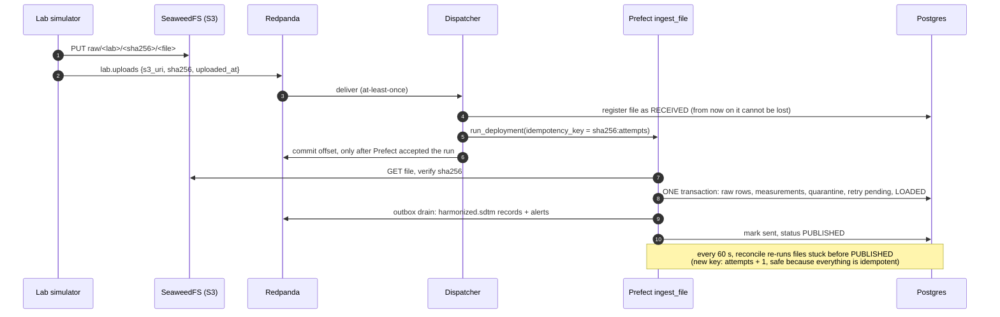
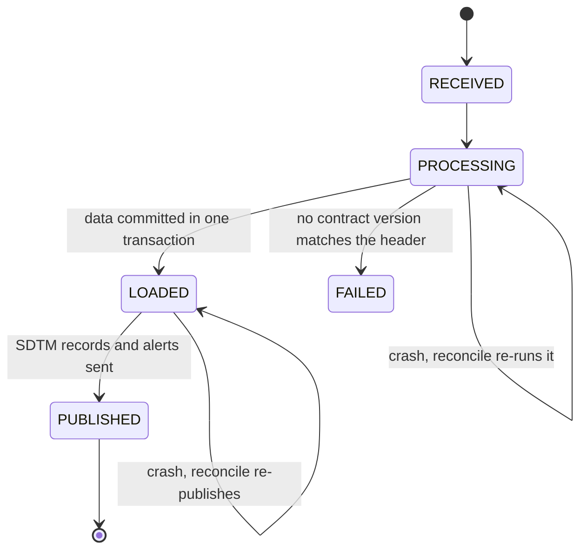
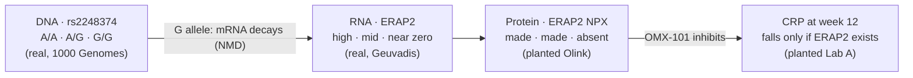
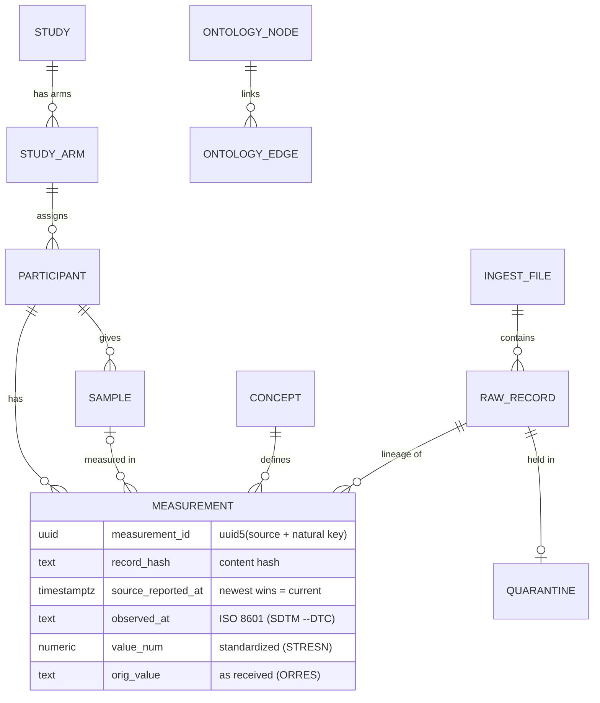

# Architecture

> **Status:** M0–M10 built: everything the brief asks for, plus the consumers, the dashboard, real open DNA/RNA data, a simulated drug trial and LLM access over MCP. `make demo` proves each topic, `make chaos` proves self-healing, and `make replay` proves replayability. The [plan and milestones](#milestones) are at the end.

**Kafka carries messages, not data.**
- Labs upload files to S3 and publish a small *claim-check* event (S3 URI + sha256).
- Prefect flows fetch the file, then harmonize it into Postgres.
- The flows publish CDISC SDTM records for the downstream consumers.

## System

| Component | Why it is there |
| --- | --- |
| Redpanda ×3 (Kafka API) | Durable, replayable event log. RF=3 with min ISR=2, so one broker can crash without losing data |
| SeaweedFS (S3) | Holds the data itself; raw files are content-addressed, so they are never overwritten. MinIO's repo was archived in Apr 2026; SeaweedFS is Apache-2.0 and has run in production since 2012 |
| Prefect | Retries, run history and UI for the pipelines; the reconcile flow re-runs stuck work |
| Postgres | The harmonized store and pipeline state; domain separation via schemas and roles |
| Curated Parquet (`s3://curated/`) | Omics bulk: the full RNA matrix and VCF land here; only a gene/variant panel goes to Postgres |
| Analysis consumer | Research domain: features, outliers and a case/control model per study, kept current from `harmonized.sdtm` and `alerts`; cis-eQTLs computed with Dask from the curated Parquet. Reads research-safe views only |
| Monitor consumer | Operations domain: logs every upload, alert and dead letter; consumer lag per group; `LAB_SILENT` freshness alerts |
| Streamlit dashboard | System state, data quality, cohort graph, lineage, analysis, ontology, plus one page per LLM-built dashboard. Chart colors validated for color-blind safety |
| MCP server (`agent`) | The LLM door: any MCP client explores the knowledge graph, queries research-safe views and saves pipelines (materialized views, refreshed by the Prefect `refresh-workspace` flow) and dashboards as YAML under `workspace/` ([agent](agent.md)) |
| FastAPI | The unified access layer: SDTM records, history and lineage behind API keys and roles; every request audited ([security](security.md)) |

## One upload, end to end

## File status

## Resilience and replay

Every run is judged by one number: the **checksum of all derived data**. It covers the measurements, the masters and the open quarantine, and leaves out wall-clock bookkeeping. The same input files must always give the golden checksum (`data/scenario/expected_checksum.txt`), however they arrive.

| Command | What happens | Verified result |
| --- | --- | --- |
| `make demo` | Clean run of the 3-day scenario, then a check per topic of the brief, then a replay | 16/16 checks ✅; replay identical ✅ |
| `make chaos` | The same scenario under five failures (timeline below) | settles by itself; golden checksum ✅ |
| `make replay` | Truncate everything derived, re-run every file from S3 under new idempotency keys | identical checksum ✅ |
| `make try-<name>` | One behaviour at a time: delivers a small file from `data/examples/`, waits, prints its input and output | a LOOK AT line per example; `make try` lists all ten |

The five failures in `make chaos`:
- 30% random task crashes, which Prefect retries.
- The dispatcher is down for 20 s; events queue in Redpanda.
- The flow-runner is `kill -9`'d mid-batch; reconcile re-runs the files it dropped.
- One of three brokers is stopped.
- The analysis consumer is down for a minute: research falls behind, ingestion doesn't, and it catches up from its committed offset.

**Why it converges:**
- IDs and hashes are derived from content.
- Measurements are append-only rows, and "current" is a view.
- Operational masters decide entity resolution.
- Held rows are retried until a fixed point.
- A newer valid report supersedes only a *bad* quarantined row. A row that is only waiting for master data always loads later, as history.
- If the same content arrives twice, the earliest delivery's lineage is kept.

How many rows wait for their master data depends on arrival order: in one run over 2,000 did. The checksum was still identical to the golden run.

## Multi-omics with open data

- **The data:**
  - DNA: real 1000 Genomes genotypes.
  - RNA: real Geuvadis expression, measured in the same individuals.
  - Both were fetched once with `make fetch`; provenance is in `data/open/SOURCES.md`.
- **The people:** 100 individuals are relabelled to the biobank DNA/RNA aliquots of P001–P100 (P061–P100 form the IBD-04 trial). This simulation step is documented.
- **The pipeline:**
  - Parsers for a wide expression matrix and a VCF; genotypes become a categorical value (call as text, ALT dosage as number).
  - The full omics files go to S3 as Parquet; only the gene/variant panel goes to Postgres.
  - The analysis consumer reads the Parquet with Dask and joins DNA and RNA through `api.samples`.
- **The result:** the known ERAP2 eQTL is recovered, rs2248374: **r = −0.83, p = 2e-26, n = 99** (P014 is on hold), about −15.0 nRPKM per G allele. The other promoter variants are null in these cells, and CRP is absent from the RNA because it is made in the liver.

## Drug trial: did OMX-101 work?

IBD-04 is a simulated placebo-controlled trial of a fictional ERAP2 inhibitor, built on the real genetics above. The question a bioinformatician asks crosses all three omics layers:

- Each participant has CRP and an Olink run at `VISIT` BASELINE and WEEK 12, plus real DNA and RNA.
- The `Drug response` check in `make demo` computes the median CRP ratio (week 12 / baseline) by arm and genotype from `api.research_findings`.

## Data model

| Schema | Owner role | Contents |
| --- | --- | --- |
| `core` | pipeline_rw | shared concepts: study, participant, sample (operational masters); concept, units, ontology |
| `ops` | pipeline_rw | ingest_file (status machine), quarantine |
| `raw` | pipeline_rw | bronze: every source row as JSONB |
| `sci` | pipeline_rw | append-only measurements (a correction is a new row) |
| `api` | (views) | the published contract, readable by api_ro, research_rw and monitor_rw |
| `research` | research_rw | analysis consumer output |
| `monitor` | monitor_rw | monitor consumer output |
| `workspace` | agent_rw | what LLMs build: one materialized view per pipeline, plus the registry and graph links (`artifact`, `link`) |

## Milestones

|  | Milestone | Status |
| --- | --- | --- |
| M0 | Foundations: compose, init (roles, migrations, reference data, buckets, topics), lint | ✅ done |
| M1 | Thin slice: simulators → S3 + Redpanda → dispatcher → Prefect → Postgres → SDTM | ✅ done |
| M2 | Quality and standards: sanitization, units, ranges, holds, alerts, corrections | ✅ done |
| M3 | Access and security: FastAPI (keys/roles, audit), DB roles, S3 identities | ✅ done |
| M4 | Resilience: reconcile, chaos, reset/replay/checksum, `make demo` **(cut line)** | ✅ done |
| M5 | Consumers and dashboards | ✅ done |
| M6 | Open multi-omics: 1000 Genomes + Geuvadis, Dask eQTL, ontology graph | ✅ done |
| M7 | Polish: README, decisions, CI, final deck, 1-hour walkthrough | ✅ done |
| M8 | Repo hygiene: index cache out of the tree, README layout | ✅ done |
| M9 | Drug trial IBD-04: arms as reference data, visits, ERAP2 protein, drug-response check | ✅ done |
| M10 | Ontology for LLMs: MCP server, agent workspace (pipelines + dashboards as a subtree) | ✅ done |
