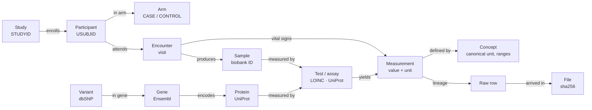

# Glossary

These are strict definitions as the system uses them. Each term names the table or field where it lives.

| Term | Definition | Lives in |
| --- | --- | --- |
| **Study** | A clinical protocol with its own participants and arms | `core.study` |
| **Participant** | One enrolled person, known only by a pseudonymous ID (`P001`) | `core.participant` |
| **USUBJID** | CDISC unique subject ID, `STUDYID-SUBJID` (`CARDIO-01-P001`) | `core.participant.usubjid` |
| **Arm** | The study group a participant belongs to: `CASE` or `CONTROL` | `core.participant.arm` |
| **Encounter** | One visit; vital signs and samples are taken at encounters | `encounter_id` |
| **Sample** | A physical specimen with a global biobank ID (`S100`); it belongs to exactly one participant | `core.sample` |
| **Operational master** | The system that owns an identity: CTMS for participants, the biobank for samples | contracts `ctms_enrollment`, `biobank_samples` |
| **Concept** | One measurable test, with its canonical unit and plausible/reference ranges | `core.concept` |
| **Measurement** | One reported value of one concept for one participant (and sample) at one time | `sci.measurement` |
| **Natural key** | The source fields that identify a measurement (e.g. sample + test code) | contract `key` |
| **measurement_id** | UUIDv5 of source + natural key: the same input always gives the same ID | `sci.measurement` |
| **Version** | One reported value of a measurement; a correction adds a version | `api.measurement_history` |
| **Current** | The version with the newest *report* time (not the newest arrival) | `api.measurement_current` |
| **NPX** | Olink Normalized Protein eXpression: log2, relative, plate-dependent; not convertible to mg/L | concepts `NPX_*` |
| **Plausible range** | Physically possible values; outside it the value is a data error | `core.concept.plausible_*` |
| **Reference range** | The clinically normal interval; it only drives `NRIND` | `core.concept.ref_*` |
| **Quarantine** | A row held back with a reason. *Retryable* rows wait for master data; the others need a correction | `ops.quarantine` |
| **Hold** | A participant with an open implausible value, excluded from research until corrected | `api.participant_hold` |
| **Claim-check** | A message that points to data in S3 instead of carrying it | topic `lab.uploads` |
| **Idempotent** | Processing the same input again changes nothing | file sha256, IDs, unique keys |
| **Lineage** | The path from a published value back to its raw row and file | `api.lineage` |
| **Contract** | One YAML file per source: column maps per version, natural key, code map | `contracts/*.yaml` |
| **eQTL** | A genetic variant associated with a gene's expression level | `research.eqtl` |
| **Dosage** | Number of ALT alleles in a genotype call: 0, 1 or 2 | GF `STRESN` |
| **nRPKM** | Geuvadis expression: reads per kilobase per million, PEER-normalized | expression concepts |
| **Curated** | Full omics files kept as Parquet in S3, outside Postgres | `s3://curated/` |
